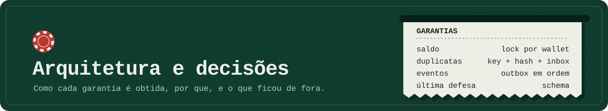
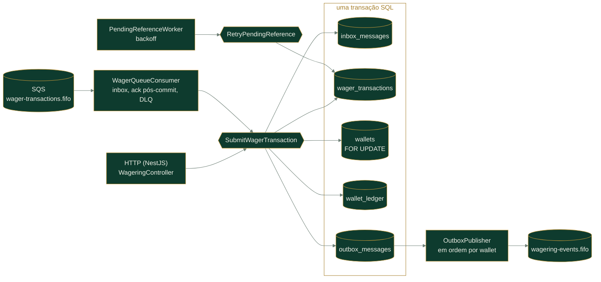
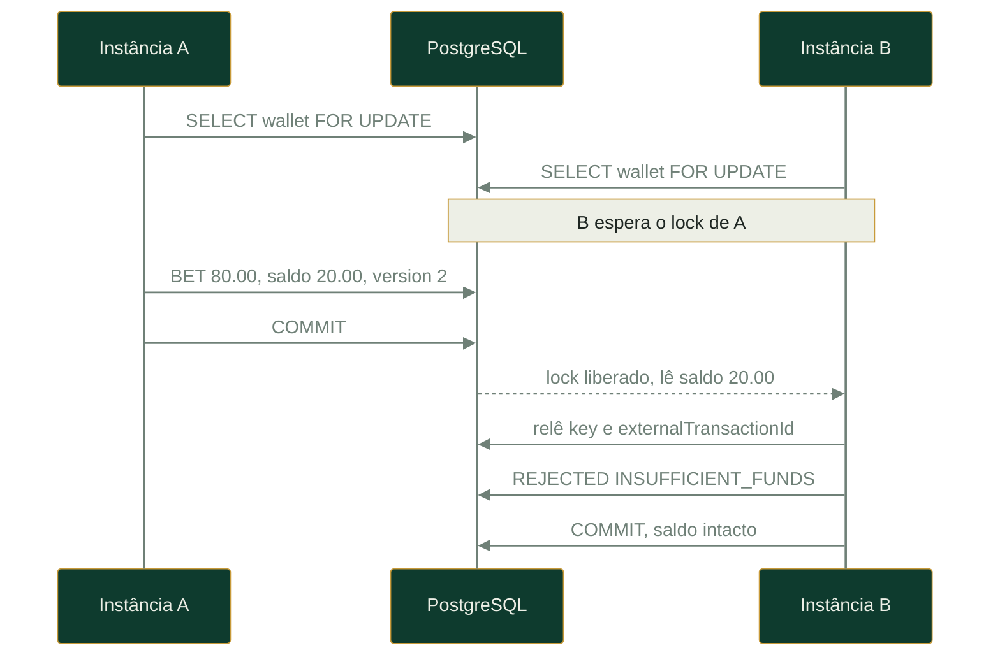
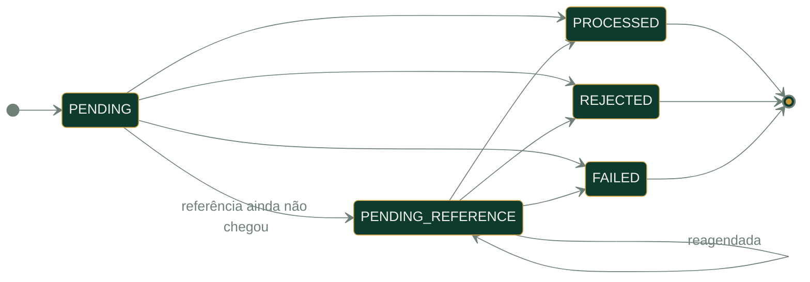

  

Este documento explica **como** cada garantia do desafio é obtida, **por que** cada escolha foi feita e **o que ficou de fora**. A regra geral: o banco é a fonte da verdade e a última linha de defesa. Toda garantia que o README pede no schema está no schema, e o código de aplicação nunca é a única proteção.

| Estrutura | Correção do saldo | Mensageria | Dados | Operação |
|---|---|---|---|---|
| [1. Visão geral](#1-visão-geral) | [4. Concorrência](#4-concorrência) | [9. SQS](#9-processamento-por-sqs) | [11. Ledger](#11-ledger) | [13. Observabilidade](#13-observabilidade) |
| [2. Camadas](#2-camadas-e-boundaries) | [5. Idempotência](#5-idempotência) | [10. Outbox](#10-transactional-outbox) | [12. Invariantes no schema](#12-invariantes-no-schema-migration-migration20261120000001_initial_schema) | [14. Testes](#14-testes) |
| [3. ORM e `Money`](#3-orm-mapeamento-do-money-e-estratégia-transacional) | [6. Regras de negócio](#6-modelo-de-transação-e-regras-de-negócio) | | | [15. Autenticação](#15-autenticação-decisão-não-implementada) |
| | [7. Fora de ordem](#7-referências-fora-de-ordem) | | | [16. Trade-offs](#16-trade-offs-limitações-e-próximos-passos) |
| | [8. Códigos de falha](#8-códigos-de-falha) | | | |

## 1. Visão geral

Cada instância roda os papéis configurados em `APP_ROLES` (`api`, `consumer`, `outbox`, `pending-reference`). Nenhum papel guarda estado entre requisições, então qualquer número de instâncias pode rodar lado a lado.

## 2. Camadas e boundaries

| Camada | Conteúdo | Depende de |
|---|---|---|
| `domain/` | `Money`, `Wallet` (aggregate root), `WagerTransaction`, `WalletLedgerEntry`, `InboxMessage`, `OutboxMessage`, eventos de integração, `settleWager` (serviço de domínio puro) | nada |
| `application/` | casos de uso, **portas** (`UnitOfWork`, repositórios, `Clock`, `IdGenerator`, `Metrics`, `AppLogger`), erros de aplicação, validação de contrato, hash canônico | `domain` |
| `infrastructure/` | adaptadores: MikroORM (`EntitySchema`, repositórios, migrations, tradução de erros do PostgreSQL), SQS, workers, pino, prom-client | `application`, `domain` |
| `interfaces/http/` | controllers NestJS, filtro de erros, guard de autenticação | `application` |

- O domínio não tem decorators de ORM nem de NestJS. Todas as classes têm construtor `private` com factories estáticas (`create`/`open`/`from`/`rehydrate`), estado mutável privado exposto por getters e transições explícitas.
- `rehydrate` reconstrói o estado persistido **sem** revalidar transições.
- O NestJS hospeda só a camada HTTP. O wiring é feito à mão em `src/container.ts` (composition root), o que deixa explícito qual adaptador implementa cada porta e permite instanciar os casos de uso em testes sem framework.
- `settleWager` concentra todas as regras de negócio (saldo, referência, reversões) sem I/O. Por isso as regras são testadas em unidade (`test/unit/wager-rules.test.ts`), e os dois casos de uso que liquidam transações (submissão e reprocessamento de referência) compartilham exatamente o mesmo código.

## 3. ORM, mapeamento do `Money` e estratégia transacional

**MikroORM 6**, como o README recomenda. Os motivos:

- `EntityManager.transactional()` com nível de isolamento explícito e `LockMode.PESSIMISTIC_WRITE` (`FOR UPDATE`), o lock por wallet de que o desenho precisa. SQL cru fica para os dois pontos em que ele é mais claro que o ORM: o `INSERT … ON CONFLICT` da inbox e a reivindicação de wallets da outbox com advisory lock;
- `EntitySchema` permite mapear sem decorators, mantendo o domínio limpo;
- migrations versionadas e reversíveis via `@mikro-orm/migrations`, listadas explicitamente (`migrationsList`), sem descoberta por filesystem em runtime.

Como o ORM é usado:

- **Records de persistência** (`schemas/records.ts`) mapeados com `EntitySchema`, e **mappers** (`mappers.ts`) que convertem record ↔ domínio via `rehydrate`. O domínio nunca vira entidade gerenciada.
- Cada caso de uso roda em um `em.fork()` próprio dentro de `em.transactional()` (`READ COMMITTED`; a reconciliação usa `REPEATABLE READ` para ter um snapshot único).
- **Identity map desligado nas leituras** (`disableIdentityMap: true`). Dentro de uma transação que espera um lock, uma releitura precisa ir ao banco. Um cache de entidade devolveria o estado antigo, que é justamente o bug de idempotência que queremos evitar.
- **Escritas nativas e explícitas** (`em.insert`, `em.insertMany`, `em.nativeUpdate`, `em.execute`) no lugar de dirty-checking. Cada SQL emitido é intencional. O update de saldo é condicionado (`WHERE id = ? AND version = ?`) e verifica `affectedRows === 1`.
- `lock_timeout`, `statement_timeout` e `idle_in_transaction_session_timeout` são configurados uma vez por conexão física (`pool.afterCreate`).

**Mapeamento do `Money`:**

- No domínio, `Money` guarda o valor como `bigint` de unidades mínimas (centavos), com escala fixa 2. Toda operação é exata: não há ponto flutuante nem arredondamento em lugar nenhum.
- Na entrada, aceita só strings decimais não negativas com até 2 casas. Rejeita `number`, `NaN`, `Infinity`, notação científica, sinais, espaços, zeros à esquerda e mais de 2 casas (rejeitar em vez de arredondar é deliberado). A saída é sempre normalizada (`"25"` vira `"25.00"`).
- No banco, `numeric(18,2)` mais uma coluna `currency char(3)`. O driver devolve `numeric` como **string**, e a string vai direto para `Money.from`. O valor nunca passa por `number`.
- Nos eventos e contratos, sempre `MoneyProps` (`{ amount: "25.00", currency: "BRL" }`).
- O modelo é multi-moeda: uma wallet por `(playerId, currency)`, operações entre moedas lançam `CurrencyMismatchError`, e uma transação em moeda diferente da wallet é `REJECTED` com `CURRENCY_MISMATCH`. Isso é testado em unidade e em integração.

## 4. Concorrência

**A unidade de concorrência é a wallet.** A estratégia é *pessimistic locking por linha*, com defesas extras:

1. `SELECT … FOR UPDATE` **na linha da wallet** (nunca um lock global). Tudo o que altera o saldo de uma wallet passa por esse lock. Wallets diferentes não disputam nada.
2. Depois do lock, a transação **relê** a chave de idempotência e o `externalTransactionId`. Alguém pode ter feito commit enquanto esperávamos.
3. O saldo é atualizado com `UPDATE … WHERE version = :anterior` e o código exige uma linha afetada. Isso é optimistic locking como segunda barreira: se um dia alguém escrever sem o lock, o resultado é conflito, nunca lost update.
4. O banco recusa o resto: `CHECK (balance_amount >= 0)`, e uma trigger exige `version + 1` exatamente quando o saldo muda. Uma *constraint trigger* adiada para o commit exige que o estado da wallet seja explicado pelo lançamento do ledger com a mesma `version` (§12).
5. Conflitos detectados pelo banco (deadlock, falha de serialização, corrida em índice único, versão divergente) re-executam **a transação inteira**, até 5 vezes com backoff aleatório curto. `lock_timeout` estourado vira erro transitório (`503` no HTTP, retry com backoff no SQS).

O cenário obrigatório (saldo 100.00, duas apostas de 80.00 ao mesmo tempo em instâncias diferentes) acontece assim:

**Por que pessimista e não só otimista:** com uma *hot wallet* (muitas apostas no mesmo saldo), o otimismo puro gera uma tempestade de retries em que quase todo mundo perde. O lock de linha enfileira os concorrentes no PostgreSQL e garante progresso. A segurança não depende do lock: depende das constraints. O lock serve para eficiência e justiça.

**Bulkhead por instância** (`KeyedSerializer`): dentro de uma instância, requisições para a mesma wallet esperam em fila FIFO em memória **antes** de pegar uma conexão do pool. Sem isso, 30 requisições para uma hot wallet ocupariam 30 conexões esperando o mesmo lock e deixariam as outras wallets sem conexão. Isso **não** é garantia de correção (outras instâncias não o veem, e a correção continua sendo do lock de linha e das constraints), nem cache de idempotência. O teste de carga mostra o efeito: com 20% do tráfego numa única wallet, o p95 das demais wallets fica em ~80 ms.

**Ordem de locks:** sempre wallet → transação. A submissão trava a wallet. O worker de referências trava a wallet e depois a transação pendente. Por isso não existe ciclo de espera entre os dois caminhos.

**Ordenação do broker é otimização:** o produtor pode usar `MessageGroupId = walletId` para ter ordem por wallet na FIFO, mas os testes mandam mensagens da mesma wallet com grupos aleatórios para forçar processamento simultâneo em várias instâncias. A correção vem do banco.

## 5. Idempotência

- O header `Idempotency-Key` é obrigatório e é a fonte da verdade. No SQS, a key vem em `data.idempotencyKey`. O padrão recomendado é `"{providerId}:{externalTransactionId}"`, sem obrigatoriedade.
- **`payloadHash`** = SHA-256 (hex) do **JSON canônico** do subconjunto de negócio `{providerId, externalTransactionId, playerId, walletId, roundId, gameId, kind, money{amount,currency}, referenceExternalTransactionId?}`. As chaves são ordenadas recursivamente por code unit, não há espaços e membros `undefined` são omitidos. O `amount` entra **já normalizado** (`"25"` e `"25.00"` são o mesmo pedido). Header, `messageId`, `occurredAt` e outros metadados de transporte não entram no hash. Implementação: `application/services/payload-hash.ts`.
- Mesma key e mesmo hash dão **replay**: a resposta original, com `idempotentReplay: true` e o **saldo observado naquele momento** (persistido em `observed_balance_amount`). Isso vale também para `REJECTED` e `PENDING_REFERENCE`.
- Mesma key com hash diferente é **conflito** (`409 IDEMPOTENCY_KEY_CONFLICT`), nunca replay.
- Mesmo `(providerId, externalTransactionId)` sob outra key é conflito (`409 EXTERNAL_TRANSACTION_CONFLICT`). Duas keys para a mesma operação do provedor seriam um débito duplicado em potencial.
- No banco: `UNIQUE (idempotency_key)` e `UNIQUE (provider_id, external_transaction_id)`. Se duas instâncias inserirem ao mesmo tempo, a segunda recebe violação de unicidade, a transação é re-executada e cai no caminho de replay ou conflito.
- No SQS existe uma segunda camada: a **inbox** `(consumer_name, message_id)`, inserida com `ON CONFLICT DO NOTHING` **na mesma transação** da mudança financeira. A mesma mensagem reentregue é descartada sem tocar em nada. Mensagens diferentes com a mesma key caem no replay normal.
- A inbox guarda o hash do `data` da mensagem e o compara quando o `messageId` se repete. Mesmo `messageId` com conteúdo diferente não é duplicata: é um erro do produtor, e a mensagem vai para a DLQ com `INBOX_MESSAGE_CONFLICT` em vez de ser confirmada em silêncio.
- Nada disso usa memória: tudo é estado persistido.

## 6. Modelo de transação e regras de negócio

`PROCESSED`, `REJECTED` e `FAILED` são terminais: qualquer transição a partir deles lança `InvalidTransactionStateError` (erro de programação).

`PENDING` existe só em memória, entre a criação e a decisão, porque a decisão acontece na mesma transação SQL. No banco, uma trigger impede alterar campos de negócio de qualquer transação e qualquer UPDATE em transação terminal. `DELETE` é proibido em todas as tabelas financeiras.

| Operação | Saldo | Ledger | Referência |
|---|---|---|---|
| `BET` | débito | 1 `DEBIT` | proibida |
| `WIN` | crédito | 1 `CREDIT` | opcional, só `BET` |
| `LOSS` | nenhum | nenhum | opcional, só `BET`; único tipo que aceita valor `0.00` |
| `REFUND` | crédito | 1 `CREDIT` | obrigatória, só `BET` `PROCESSED`, mesmo valor |
| `ROLLBACK` | inverso da referência | 1 lançamento invertido | obrigatória: `BET` (credita), `WIN` ou `REFUND` (debitam) |
| `OPENING` | crédito | 1 `CREDIT` | interno, criado com a wallet; recusado na API e na fila (`400 KIND_NOT_ALLOWED`) |

A referência é resolvida por `(providerId, referenceExternalTransactionId)` e precisa ter o mesmo provider, player, wallet, moeda e rodada (senão `REFERENCE_MISMATCH`).

> [!IMPORTANT]
> **Interpretações adotadas.** O README do desafio pede que elas sejam documentadas.

1. **Uma referência é revertida no máximo uma vez, por qualquer tipo.** O README diz "não pode ser revertida duas vezes pelo mesmo tipo". Permitir `REFUND` e depois `ROLLBACK` da mesma `BET` creditaria a aposta duas vezes, então a regra adotada é mais estrita. É garantida no banco pelo índice único parcial `wager_tx_single_reversal_uq (reference_transaction_id) WHERE kind IN ('REFUND','ROLLBACK') AND status = 'PROCESSED'`. Um `ROLLBACK` de um `REFUND` é outra referência, então continua permitido.
2. `ROLLBACK` de `LOSS` e de outro `ROLLBACK` não é permitido (`REFERENCE_KIND_NOT_ALLOWED`): `LOSS` não moveu saldo, e reverter uma reversão cria cadeias ambíguas.
3. Referência que existe mas está `REJECTED` ou `FAILED` resulta em `REFERENCE_NOT_PROCESSED`. Referência que existe mas ainda está `PENDING_REFERENCE` mantém a dependente pendente.
4. Wallet inexistente (no path ou no corpo) é `404 WALLET_NOT_FOUND` e **não** é persistida: não há wallet para associar e auditar. No SQS, a mensagem vai para a DLQ com esse motivo.
5. Player diferente do dono da wallet é `REJECTED` (`PLAYER_WALLET_MISMATCH`), persistido e auditável. A resposta e o evento levam `balance: null`: quem informa a wallet de outro jogador não descobre o saldo dela.
6. Valor zero só é aceito em `LOSS`. Os outros tipos exigem `> 0`.
7. Reversão que deixaria o saldo negativo é `REJECTED` com `REVERSAL_INSUFFICIENT_FUNDS`, distinto de `INSUFFICIENT_FUNDS`, e fica auditável.
8. Rejeições de negócio não geram ledger nem alteram saldo. Geram o evento `WagerTransactionRejected`.
9. **Uma `BET` é paga ou revertida, nunca as duas coisas.** `WIN` ou `LOSS` de uma `BET` que já teve `REFUND` ou `ROLLBACK` é `REJECTED` com `REFERENCE_ALREADY_REVERSED`: a rodada foi cancelada. No sentido contrário, `REFUND` ou `ROLLBACK` de uma `BET` que já pagou um `WIN` é `REJECTED` com `REFERENCE_ALREADY_SETTLED`, porque devolveria a aposta por cima do prêmio. O provedor desfaz o `WIN` primeiro (`ROLLBACK` do `WIN`) e então pode estornar a `BET`. `LOSS` não bloqueia o estorno, porque não moveu saldo. As duas verificações rodam sob o lock da wallet, que é a mesma da referência.

## 7. Referências fora de ordem

- `REFUND`, `ROLLBACK` (e `WIN`/`LOSS` com referência) que chegam antes da referência são persistidos como `PENDING_REFERENCE`, com `next_attempt_at` e `attempts`, e emitem `WagerTransactionPendingReference`. A resposta é `202`.
- O `PendingReferenceWorker` (agendado, roda em qualquer número de instâncias) busca as pendentes vencidas e reprocessa cada uma em sua própria transação, com o mesmo `settleWager`.
- **Backoff exponencial:** `min(2 s × 2^tentativa, 5 min)`, **10 tentativas**, cerca de 17 minutos no total. A justificativa: em entregas at-least-once, a referência costuma chegar segundos depois, e uma janela de ~17 min cobre redeliveries do SQS (visibilidade de 30 s com até 5 recebimentos) e incidentes curtos de um provedor sem deixar transações pendentes por horas. Tudo é configurável por env.
- **Atalho:** quando uma transação termina (processada, rejeitada ou com falha), a mesma transação SQL antecipa `next_attempt_at` das dependentes que esperam por ela (`wakeDependents`). Na prática, a dependente é decidida no próximo ciclo do worker (~1 s), não no próximo degrau do backoff: aplicada se a referência foi processada, `REFERENCE_NOT_PROCESSED` se não foi.
- **Falha técnica no reprocessamento** (lock timeout, banco fora, bug): a tentativa é contada e `next_attempt_at` vai para o próximo degrau do backoff, numa transação separada. Assim uma pendente que sempre falha não fica no topo da fila travando as outras. Esgotadas as tentativas, ela termina `FAILED` com `PROCESSING_RETRIES_EXHAUSTED`, sem tocar em saldo, ledger ou eventos.
- **Esgotado o limite**, a transação vira `REJECTED` com `REFERENCE_NOT_FOUND`, e o evento `WagerTransactionRejected` é publicado.

## 8. Códigos de falha

| `failureCode` | Status da transação | O que o provedor deve fazer |
|---|---|---|
| `INSUFFICIENT_FUNDS` | `REJECTED` | final; não reenviar |
| `REVERSAL_INSUFFICIENT_FUNDS` | `REJECTED` | final; caso operacional (ex.: ganho já gasto), tratar manualmente |
| `CURRENCY_MISMATCH` | `REJECTED` | corrigir e enviar **nova** transação |
| `PLAYER_WALLET_MISMATCH` | `REJECTED` | corrigir e enviar nova transação |
| `REFERENCE_NOT_FOUND` | `REJECTED` | referência nunca chegou; enviar a referência e uma nova reversão |
| `REFERENCE_MISMATCH` | `REJECTED` | referência de outro player/wallet/moeda/rodada; corrigir |
| `REFERENCE_KIND_NOT_ALLOWED` | `REJECTED` | tipo de referência inválido para a operação |
| `REFERENCE_NOT_PROCESSED` | `REJECTED` | referência rejeitada/falha; nada a reverter |
| `REFERENCE_AMOUNT_MISMATCH` | `REJECTED` | reversão parcial não é suportada |
| `REFERENCE_ALREADY_REVERSED` | `REJECTED` | aposta já estornada (não há o que reverter nem pagar); final |
| `REFERENCE_ALREADY_SETTLED` | `REJECTED` | aposta já paga por um `WIN`; fazer `ROLLBACK` do `WIN` antes de estornar |
| `PROCESSING_RETRIES_EXHAUSTED` | `FAILED` | falha de infraestrutura persistente (mensagem na DLQ, ou pendente que falhou em todas as tentativas); operação manual |
| `INTERNAL_INVARIANT_VIOLATION` | `FAILED` | o banco recusou um estado impossível (bug); operação manual |

Erros que **não** viram transação (não há o que persistir) usam `error.code`: `INVALID_PAYLOAD`, `IDEMPOTENCY_KEY_REQUIRED`, `KIND_NOT_ALLOWED`, `INVALID_CURSOR`, `WALLET_NOT_FOUND`, `NOT_FOUND`, `IDEMPOTENCY_KEY_CONFLICT`, `EXTERNAL_TRANSACTION_CONFLICT`, `WALLET_ALREADY_EXISTS`, `TRANSIENT_INFRASTRUCTURE_ERROR`, `CONCURRENCY_CONFLICT`, `INTERNAL_ERROR`. O campo `retryable` diz se reenviar a mesma requisição pode funcionar. O mapeamento HTTP está no [README](./README.md#códigos-http-iguais-em-todos-os-endpoints) e em `interfaces/http/error-mapping.ts`: cada situação tem um único status, igual em todos os endpoints, e o provedor nunca precisa ler a mensagem para decidir se reenvia.

## 9. Processamento por SQS

`infrastructure/sqs/wager-consumer.ts`:

- Long polling, até 10 mensagens. Mensagens do mesmo `MessageGroupId` são processadas em sequência, e grupos diferentes em paralelo.
- Valida o envelope e o `data` com **o mesmo parser** do HTTP e chama **o mesmo caso de uso** (`SubmitWagerTransaction`), com o contexto da inbox.
- **Ack (`DeleteMessage`) somente depois do commit.** Se o processo morrer entre o commit e o ack, a mensagem volta após o visibility timeout, bate na inbox e é só confirmada. Existe um teste que mata o processo exatamente nesse ponto.
- **Falha no próprio ack** (rede, receipt handle expirado) não é falha de processamento: a transação já foi confirmada. A falha é registrada (`sqs_messages_total{outcome="ack-failed"}`), a mensagem volta e a inbox a reconhece. Antes ela caía no caminho de erro transitório e, no último recebimento, ia para a DLQ como `RETRIES_EXHAUSTED` uma transação que tinha dado certo.
- **Classificação de erros:**
  - **negócio** (`PROCESSED`, `REJECTED`, `PENDING_REFERENCE`, replay, mensagem duplicada): ack;
  - **transitório** (banco fora, `lock_timeout`, conflito que esgotou os retries internos, erro desconhecido): `ChangeMessageVisibility` com backoff `min(base × 2^(n-1), 300 s)`. As mensagens seguintes do mesmo grupo são devolvidas para manter a ordem;
  - **permanente** (JSON inválido, tipo desconhecido, payload inválido, wallet inexistente, conflito de idempotência, `messageId` reutilizado com outro conteúdo, violação de invariante): envio explícito à DLQ com o atributo `deadLetterReason`, depois ack;
  - **limite de tentativas:** ao atingir `SQS_MAX_RECEIVE_COUNT` recebimentos, a mensagem vai para a DLQ com `RETRIES_EXHAUSTED`, e a transação é registrada como `FAILED` (`PROCESSING_RETRIES_EXHAUSTED`) quando o banco permite (best effort; se o problema for o próprio banco, a DLQ é a trilha de auditoria). A fila também tem `RedrivePolicy` com o mesmo `maxReceiveCount`, como rede de segurança para *poison pills* que derrubam o processo.
- **SIGTERM:** para de buscar mensagens (aborta o long poll), conclui as mensagens em andamento e devolve as recebidas e não iniciadas com visibilidade 0. Depois fecha HTTP e pools. Verificado no teste de restart (`SIGTERM` sai com código 0) e com `docker compose stop`.

## 10. Transactional Outbox

- Eventos são gravados em `outbox_messages` **na mesma transação** que a inbox, a transação, a wallet e o ledger. Ou tudo é confirmado junto, ou nada é. Um teste injeta uma falha depois de todas as escritas e verifica que nada ficou.
- **O id do outbox é o `eventId`.** Uma republicação carrega a mesma identidade.
- **A ordem é por wallet**, e é ela que os consumidores precisam: `WalletBalanceChanged` da versão 3 nunca pode chegar antes da versão 2. O `OutboxPublisher` trabalha por agregado, não por linha, em uma transação que fica aberta durante o envio:
  1. escolhe as wallets cujo evento **mais antigo** ainda não publicado está vencido e reivindica cada uma com `pg_try_advisory_xact_lock`. Uma wallet é publicada por um publisher de cada vez, em qualquer número de instâncias, e a que está com outro publisher é pulada, sem espera;
  2. lê os eventos pendentes dessas wallets em ordem (`occurred_at, id`), alternando entre elas para que nenhuma monopolize o lote;
  3. envia com `SendMessageBatch` (`MessageGroupId = aggregateId`, `MessageDeduplicationId = eventId`), **no máximo um evento por wallet em cada chamada**, e para a wallet no primeiro evento recusado. Os seguintes ficam intocados e saem depois do retry, atrás dele;
  4. marca `published_at` e faz commit. O índice parcial `outbox_pending_by_aggregate_idx (aggregate_id, occurred_at, id) WHERE published_at IS NULL` atende as duas leituras.
- O que isso cobre, com teste para cada caso:
  - **vários publishers concorrentes:** cada evento publicado exatamente uma vez e em ordem por wallet;
  - **SQS recusa um evento do meio:** `scheduleRetry` com backoff exponencial (`attempts`, `next_attempt_at`, `last_error`), e os eventos seguintes da mesma wallet esperam por ele. O teste recusa o primeiro evento e confere a ordem recebida, evento por evento;
  - **processo morre antes de publicar:** a linha está commitada e outra instância a publica;
  - **processo morre depois de enviar e antes do commit:** o rollback libera as wallets, e outra instância reenvia com o mesmo `eventId`. A dedup da FIFO absorve o reenvio dentro de 5 minutos, e fora dessa janela o consumidor deduplica por `eventId`. Entrega at-least-once, nunca perde. Testado com `SIGKILL` real nesse ponto.
- O custo: uma wallet muito ativa publica um evento por chamada ao SQS. No teste de carga (hot wallet com 20% do tráfego), a outbox esvazia em 0,2 s depois da carga.
- Eventos: `WagerTransactionProcessed` (inclusive `LOSS`), `WagerTransactionRejected`, `WalletBalanceChanged` (só quando o saldo muda, inclusive na abertura) e `WagerTransactionPendingReference`. Cada um é uma subclasse de `IntegrationEvent<T>` com `eventType` e `version` no tipo. `data` carrega `MoneyProps`, nunca `Money`.

## 11. Ledger

- Imutável na estrutura: a classe não tem campos mutáveis nem métodos de transição (e a instância é `Object.freeze`). A factory valida `balanceBefore ± money === balanceAfter`.
- Cada lançamento carrega `wallet_version`, formando uma **cadeia sem buracos** por wallet: `UNIQUE (wallet_id, wallet_version)`, e uma trigger exige `balance_before = balance_after` do lançamento anterior. Essa mesma chave é o cursor da paginação (estável e único), codificado em base64url para ser opaco.
- Uma transação gera no máximo um lançamento por wallet (`UNIQUE (wallet_id, transaction_id)`). `LOSS` e rejeições não geram lançamento.
- Partidas dobradas não foram implementadas (diferencial opcional, §16).

## 12. Invariantes no schema (migrations em `infrastructure/persistence/migrations`)

| Garantia | Mecanismo no PostgreSQL |
|---|---|
| uma wallet por `playerId + currency` | `UNIQUE (player_id, currency)` |
| saldo nunca negativo | `CHECK (balance_amount >= 0)` (e nos saldos do ledger) |
| toda alteração de saldo tem lançamento, e vice-versa | *constraint trigger* `DEFERRABLE INITIALLY DEFERRED` em `wallets`: no commit, o lançamento com `wallet_version = version` precisa existir e ter `balance_after = balance_amount` |
| `version` muda exatamente quando o saldo muda, sempre +1 | trigger `wallet_guard_version` |
| lançamento aritmeticamente correto | `CHECK` de `balance_after = balance_before ± amount` |
| cadeia do ledger contínua | trigger `ledger_check_chain` + `UNIQUE (wallet_id, wallet_version)` |
| moeda do lançamento = moeda da wallet | FK composta `(wallet_id, currency) → wallets(id, currency)` |
| ledger append-only | triggers que proíbem `UPDATE`, `DELETE` e `TRUNCATE` |
| idempotência e unicidade da operação do provedor | `UNIQUE (idempotency_key)`, `UNIQUE (provider_id, external_transaction_id)` |
| uma reversão por referência | índice único parcial `wager_tx_single_reversal_uq` |
| uma abertura por wallet | índice único parcial `wager_tx_single_opening_uq` |
| `REFUND`/`ROLLBACK` têm referência; rejeição tem `failure_code`; terminal tem `processed_at` | `CHECK`s em `wager_transactions` |
| transação terminal e campos de negócio imutáveis; nada é apagado | triggers `wager_tx_guard_immutable` e `forbid_delete` |
| inbox deduplicada | `PRIMARY KEY (consumer_name, message_id)` |

Cada linha tem um teste em `test/integration/schema.test.ts`, executado com SQL cru para provar que a proteção está no banco, não no código. As migrations são reversíveis (`down` remove tudo); o teste aplica `up → down → up` num banco descartável.

## 13. Observabilidade

- **Logs JSON** (pino) com `correlationId`, `messageId`, `transactionId`, `walletId`, `providerId`, `instanceId`. O `correlationId` vem do header `X-Correlation-Id` (ou é gerado) e volta na resposta; no SQS é o `correlationId`/`messageId` do envelope. Valores financeiros e payloads não são logados: os campos `money`, `balance`, `payload`, `body` e `initialBalance` são redigidos por configuração.
- **Métricas** (`GET /metrics`, Prometheus):
  - `wager_transactions_total{status,kind,source}`: transações por status;
  - `wager_duplicates_total{source,type}`: replays, hits de inbox e reuso de `externalTransactionId`;
  - `wager_idempotency_conflicts_total`;
  - `wager_retries_total{operation,reason}`;
  - `wallet_lock_conflicts_total{kind}`: lock timeout, deadlock, serialização, versão, corrida de índice único;
  - `sqs_dlq_messages_total{reason}` e `sqs_messages_total{outcome}` (`acked`, `ack-failed`, `retry-scheduled`, `dead-lettered`, `released`);
  - `outbox_lag_seconds` (idade do evento pendente mais antigo), `outbox_pending_messages`, `outbox_published_total`, `outbox_publish_failures_total`;
  - `wager_processing_duration_seconds{source}` (histograma de latência);
  - `wallet_reconciliation_divergences_total`;
  - `wager_pending_reference_transactions` (todas as que esperam referência, vencidas ou não).
- **Health:** `/health/live` diz só se o processo está vivo. `/health/ready` checa PostgreSQL (`select 1`) e SQS (`GetQueueAttributes`), com timeout de 2 s cada, e responde `503` se algum estiver fora. Os dois são públicos.
- **Reconciliação** (`POST /wallets/:id/reconciliation`): em snapshot `REPEATABLE READ`, compara o saldo armazenado com Σcréditos − Σdébitos e com o `balance_after`/`version` do último lançamento. Uma divergência nunca é corrigida: é logada em `error`, contada em métrica e sinalizada na resposta (`consistent: false`).

## 14. Testes

| Cenário obrigatório | Onde |
|---|---|
| `Money`: escala, sem arredondamento, entradas inválidas | `test/unit/money.test.ts` |
| invariantes da `Wallet` | `test/unit/wallet.test.ts` |
| regras de `BET`/`WIN`/`LOSS`/`REFUND`/`ROLLBACK`, conflito de moeda, key com payload divergente | `test/unit/wager-rules.test.ts` |
| migrations e constraints | `test/integration/schema.test.ts` |
| atomicidade entre wallet, ledger, inbox e outbox | `test/integration/api.test.ts` (atomicity) |
| inbox e redelivery; retry e DLQ | `test/integration/sqs-consumer.test.ts` |
| publishers concorrentes; morte antes e depois de publicar; retry | `test/integration/outbox.test.ts` |
| 1. a mesma aposta 50× em paralelo → um débito | `test/concurrency/hot-wallet.test.ts` |
| 2. disputa de saldo (100.00 / 2 × 80.00) | `test/concurrency/hot-wallet.test.ts` |
| 3. wallets distintas em paralelo | `test/concurrency/hot-wallet.test.ts` |
| 4. ≥ 3 processos simultâneos (HTTP + SQS na mesma wallet) | `test/concurrency/multi-instance.test.ts` |
| 5. worker morto depois do commit e antes do ack (`SIGKILL` real) | `test/concurrency/multi-instance.test.ts` |
| 6. dois publishers sobre a mesma outbox | `test/integration/outbox.test.ts` |
| 7. `ROLLBACK`/`REFUND` antes da referência | `sqs-consumer.test.ts`, `multi-instance.test.ts`, `api.test.ts` |
| 8. reinício (`SIGKILL` + `SIGTERM` sob carga) e consistência final | `test/concurrency/multi-instance.test.ts` |
| PostgreSQL derrubado (`docker kill`) no meio da carga, HTTP + SQS | `test/resilience/infra-outage.test.ts` |
| SQS congelado (`docker pause`): HTTP segue, outbox acumula e drena | `test/resilience/infra-outage.test.ts` |
| históricos aleatórios fora de ordem e com duplicatas (property-based) | `test/unit/wager-properties.test.ts` |
| uma `BET` nunca é paga e estornada ao mesmo tempo | `wager-rules.test.ts`, `wager-properties.test.ts`, `api.test.ts` |
| wallet de outro jogador não revela o saldo | `wager-rules.test.ts`, `api.test.ts` |
| ordem por wallet quando o SQS recusa um evento do meio | `test/integration/outbox.test.ts` |
| `messageId` reutilizado com outro conteúdo vai para a DLQ | `test/integration/sqs-consumer.test.ts` |
| falha no ack depois do commit não vira falha de processamento | `test/integration/sqs-consumer.test.ts` |
| pendente que sempre falha não trava a fila; termina `FAILED`; dependentes de rejeitada acordam | `test/integration/pending-reference.test.ts` |
| workers ociosos não acumulam listeners | `test/unit/polling-worker.test.ts` |

- **Invariante final:** todo arquivo de integração e concorrência termina com `assertGlobalConsistency()`, que verifica `wallet.balance == Σ ledger` e `version == último wallet_version` para **todas** as wallets do banco, não só as do teste.
- Paralelismo real: requisições HTTP simultâneas contra um PostgreSQL real e, nos testes multi-instância, processos `bun` separados criados com `Bun.spawn`. A falha "depois do commit e antes do ack" é injetada por `FAULT_INJECTION=crash-after-commit`, que faz `SIGKILL` no próprio processo naquele ponto exato. É um hook que só existe se a variável estiver definida.
- **Property-based (fast-check):** em vez de escolher exemplos, o gerador (`test/support/wager-arbitraries.ts`) cria históricos aleatórios de `BET`/`WIN`/`LOSS`/`REFUND`/`ROLLBACK` com referências para trás, para frente e para ids que nunca chegam, valores coerentes ou não com a referência, e um plano de entrega embaralhado com duplicatas. O teste aplica cada entrega com `settleWager`, a mesma função pura usada em produção, e reprocessa as pendentes como o worker faz. Em cada passo e no final, verifica: saldo nunca negativo; saldo = Σ ledger; uma versão por lançamento; uma transação por `externalTransactionId`; toda transação termina em estado terminal coerente; reversões só valem para a operação certa, uma vez, no sentido oposto; nenhuma `BET` estornada fica com um `WIN` de pé; referência inexistente termina em `REFERENCE_NOT_FOUND`. Também verifica que, só com créditos, a ordem de entrega não muda o saldo final, e que a aritmética de `Money` é exata e sobrevive ao formato de fio. Quando uma propriedade falha, o fast-check reduz o histórico ao menor contraexemplo e imprime a semente para reproduzir.
- **Resiliência de infraestrutura:** com duas instâncias reais sob carga, o teste mata o container do PostgreSQL. A readiness passa a `503` e a liveness continua `200`. Os clientes HTTP recebem `503` com `Retry-After` (nunca `500`) e reenviam com a mesma chave. As mensagens SQS voltam para a fila e são reprocessadas. Depois do restart, cada operação tem exatamente uma linha `PROCESSED`, os saldos e versões batem e a DLQ está vazia. No segundo cenário o LocalStack é congelado: o caminho financeiro não depende do broker, então o HTTP segue respondendo `201`, os eventos se acumulam na outbox e são publicados quando o SQS volta. Para isso funcionar, nenhuma chamada fica pendurada: o driver tem `query_timeout`, `connectionTimeoutMillis` e timeout de aquisição do pool, o SDK do SQS tem `requestTimeout`/`connectionTimeout`, e os erros de conexão perdida são classificados como transitórios (`DATABASE_UNAVAILABLE`).
- Determinismo: cada arquivo usa filas próprias (nomes aleatórios) e wallets próprias. Esperas são por condição (`waitFor`), não por `sleep` fixo.

## 15. Autenticação (decisão: não implementada)

> [!NOTE]
> Autenticação não vale pontos, e o tempo foi investido em correção, concorrência e mensageria.

O ponto de extensão está no código: `ProviderAuthGuard` (`interfaces/http/controllers.ts`) é um guard no-op aplicado a todos os endpoints de wallet e wagering. Health e métricas ficam sem guard.

Desenho que eu adotaria:

- **Keycloak** no `docker-compose`, um *client* confidencial por provedor, fluxo **OAuth2 client credentials**;
- o guard valida o JWT (assinatura via JWKS em cache, `iss`, `aud`, `exp`) e extrai o `azp`/`client_id`;
- regra de domínio: o `providerId` do corpo precisa ser igual ao provedor do token (senão `403`), o que impede um provedor de operar transações de outro;
- operações administrativas (`POST /wallets`, reconciliação) exigem um *role* separado;
- mensagens SQS são canal interno confiável (conforme o README), mas o `providerId` delas passa pelas mesmas validações de domínio.

## 16. Trade-offs, limitações e próximos passos

- **Hot wallet:** o throughput de uma única wallet é limitado por uma transação por vez (≈ 1 / tempo de lock). É inerente a um saldo único e consistente. A mitigação é o bulkhead, que impede que ela prejudique as outras wallets. Para escalar além disso seria preciso particionar o saldo (sub-wallets) ou fazer pre-authorization com reserva, o que está fora do escopo.
- **Transação aberta durante a publicação** da outbox: simples e correto, mas segura conexões enquanto fala com o SQS (limitado pelo `requestTimeout` do SDK). Em escala maior, eu trocaria por *lease* (`locked_until`) em uma transação curta.
- **Relógio:** agendamentos (`next_attempt_at`) usam o relógio da aplicação. Supõe NTP entre instâncias; um desvio de poucos segundos só antecipa ou atrasa um retry.
- **`FAILED` é best effort:** se o banco está fora, a falha é registrada só na DLQ. Reprocessar a DLQ é operação manual (não há redrive automático).
- **Partidas dobradas** não foram implementadas. O ledger é de uma entrada por wallet, com cadeia de versão e trigger de consistência. O próximo passo seria uma conta-contrapartida por provedor/house.
- **Moeda única nos dados:** o modelo e os testes são multi-moeda, mas a escala é fixa em 2 casas para todas as moedas (como o README define). Moedas com 0 ou 3 casas exigiriam escala por moeda.
- **Retenção:** inbox e outbox publicada crescem indefinidamente. Em produção, um job de limpeza por idade (ex.: 14 dias, alinhado à retenção do SQS) resolveria.
- **Imagem e CI:** o container roda com o usuário sem privilégios `bun` da imagem oficial, e o workflow de CI usa um token só de leitura (`permissions: contents: read`).
- **Teste de carga** roda numa única máquina (gerador, 3 instâncias, PostgreSQL e LocalStack dividindo 4 vCPUs). Os números são um piso, não capacidade. Ver `docs/load-test-results.md`.

---

Voltar ao [README](./README.md). Números do teste de carga em [`docs/load-test-results.md`](./docs/load-test-results.md).
