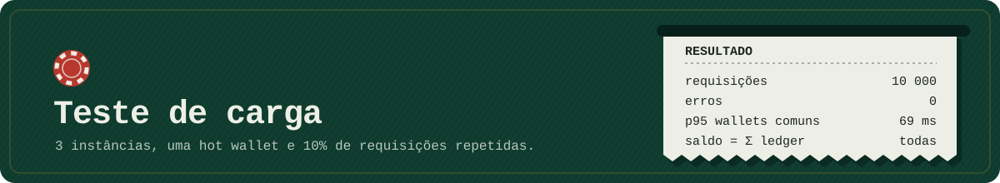

  

Gerado por `bun run test:load` em 2026-11-20T15:59:50.149Z. Voltar ao [README](../README.md).

## Ambiente

- 3 instâncias da aplicação (processos Bun separados, todos os papéis), PostgreSQL 16 e LocalStack em Docker na mesma máquina
- Máquina: 4 vCPU e 15.7 GiB de RAM, com o gerador de carga rodando nela também
- Pool de 25 conexões por instância e `lock_timeout` de 2 s

## Metodologia

- 200 wallets e 1 hot wallet, todas abertas com 1000.00 BRL
- 10 000 requisições HTTP de 64 clientes simultâneos, alternando entre as instâncias
- Mistura de 70% `BET 1.00` e 30% `WIN 2.00`; 20% das operações novas vão para a hot wallet e 10% das requisições repetem uma anterior (mesma `Idempotency-Key`)
- Depois da carga, o teste espera a outbox esvaziar e confere `balance == Σ ledger` em todas as wallets do banco

## Resultado

| Métrica | Valor |
|---|---|
| duração | 46.9 s |
| vazão | 213 req/s |
| latência p50 / p95 / p99, todas | 38.9 / 1821.4 / 2376.1 ms |
| latência p50 / p95 / p99, wallets comuns (8001 req) | 32.4 / 82.0 / 277.4 ms |
| latência p50 / p95 / p99, hot wallet (1999 req) | 1374.4 / 2376.1 / 2643.1 ms |
| latência máxima | 2854.1 ms |
| taxa de erro (5xx ou rede) | 0.00% (0) |
| status HTTP | 200: 1048, 201: 8952 |
| duplicatas detectadas (replays) | 1048 |
| conflitos de lock (timeouts, corridas, deadlocks) | 0 |
| retries de transação | 0 |
| outbox esvaziada após a carga | 0.2 s (atraso medido no fim: 0.0 s) |
| saldo == ledger | ✅ todas as wallets |

## Como ler os números

- `201` é processada, `200` é replay idempotente e `422` é rejeição de negócio (saldo insuficiente na hot wallet).
- A hot wallet é o gargalo por desenho: toda operação nela segura o mesmo lock de linha, então a vazão dela é de uma transação por vez (≈ 1 / tempo de lock). As requisições dela esperam em fila, primeiro no bulkhead da instância e depois no lock, e é isso que puxa o p95 e o p99 gerais. As wallets comuns não ficam mais lentas porque o bulkhead impede que a hot wallet tome o pool de conexões.
- O gerador é de malha fechada: clientes presos em requisições da hot wallet não enviam outras, então a vazão global também é limitada pela fatia da hot wallet. Um teste de malha aberta mostraria a capacidade das wallets comuns.

> [!NOTE]
> Gerador, 3 instâncias, PostgreSQL e LocalStack dividem a mesma máquina e as mesmas CPUs. Os números são um piso, não uma medida de capacidade.
